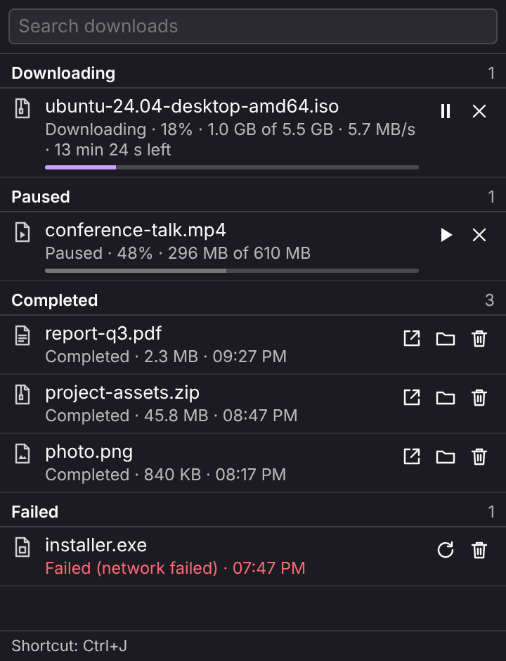

# Downloads Sidebar for Firefox

Your downloads in a Firefox sidebar, like the History sidebar. Live progress, search, and pause / resume / cancel / retry / open / show in folder / remove.

## Install

1. Open `about:debugging#/runtime/this-firefox`
2. Click **Load Temporary Add-on...**
3. Select `manifest.json`

Needs Firefox 78+. Temporary add-ons are removed when Firefox restarts.

## Use Ctrl+J

Firefox already uses Ctrl+J for its own Downloads panel, so free it first:

1. Open `about:keyboard`
2. Find **Tools > Downloads** and delete it or change it
3. Reload the extension in `about:debugging`

Now Ctrl+J opens and closes the sidebar. If it doesn't work, set any other key in `about:addons` > gear icon > **Manage Extension Shortcuts**.

## Limitations

- Firefox's own Downloads panel can't be hidden or replaced.
- The sidebar can't open itself when a download starts.
- Speed and time left are estimates (progress is checked every second).
- Retry starts a new download from the original URL.
- Private window downloads show only if the extension is allowed in private windows.

## Extension
https://addons.mozilla.org/en-US/firefox/addon/better-downloads-sidebar/